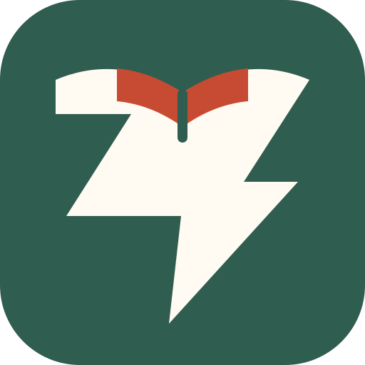

<p align="center">
  
</p>

<p align="center">
  
</p>

**A calm, open-source EPUB, PDF, and FictionBook 2 (FB2) reader for the web, desktop, Android, and iOS.**

[Read on the web](https://books.guaka.org) · [Download the Android APK](https://github.com/guaka/bookstr/releases/latest) · [View the source](https://github.com/guaka/bookstr)

> [!IMPORTANT]
> Bookstr is early-stage software. Expect rough edges and incomplete platform parity; keep copies of books you care about.

## Reading without the noise

Bookstr is built around the book rather than the storefront. Open an EPUB, PDF, or FictionBook 2 (FB2) title, pick a comfortable theme, and keep reading without accounts, recommendations, or attention-grabbing chrome.

Your library and reading state stay local. Optional Nostr sync carries favorites, progress, and saved vocabulary between devices without making Bookstr the owner of your identity or data.

## Highlights

- **EPUB, PDF, and FB2 reading** with focused, responsive reader interfaces.
- **Library, search, and reading tools** including themes, progress tracking, text-to-speech, dictionary lookup, and saved vocabulary.
- **Local-first, optional sync** with content-addressed delivery, SHA-256 verification, and Nostr.
- **Public OPDS catalogs** fetched directly by your device, plus optional Blossom mirrors.
- **Native Android and iOS apps**, an Electron desktop app, and a dependency-free web client—all AGPL-licensed.

## Try Bookstr

| Platform | Status | Start here |
| --- | --- | --- |
| Web | Live early preview; no installation required | [Open books.guaka.org](https://books.guaka.org) |
| Android | Early-access APK for Android 8.1 and newer | [Download the latest APK](https://github.com/guaka/bookstr/releases/latest) |
| iPhone and iPad | Native SwiftUI app available from source; no App Store or TestFlight release yet | [Build the iOS app](./ios/README.md) |
| Desktop (Electron) | Early-access local app for macOS 14+, Windows 10/11, and Linux | [Open the desktop README](./desktop/README.md) |

### Install on Android

1. Download the APK on your Android device.
2. If prompted, allow your browser or file manager to install apps from this source.
3. Open the downloaded file and choose **Install**.

The early-access APK is distributed through GitHub Releases and does not update automatically.

Reading never requires Nostr. Bookstr prefers external signers so private keys can stay outside the app; see [NOSTR.md](./NOSTR.md) for the event formats and privacy model.

## Develop Bookstr

The web, desktop, Android, and iOS clients share formats, fixtures, and reader behavior while retaining native shells. See the [client architecture](./docs/CLIENT_ARCHITECTURE.md) and [capability matrix](./docs/CLIENT_CAPABILITIES.md).

### Web

```bash
./webdev.sh
```

The development server opens Bookstr at `http://localhost:11111`. Run the web tests with:

```bash
node --test web/tests/*.test.mjs scripts/*.test.mjs shared/catalog/*.test.mjs shared/design-tokens/*.test.mjs
```

### Android

The Android project supports API 27 and newer. See the [Android build guide](./android/README.md) for the JDK, SDK, NDK and Boost prerequisites.

```bash
cd android
./gradlew testDebugUnitTest
./gradlew assembleDebug
./gradlew connectedDebugAndroidTest # requires a device or emulator
```

### iOS

Open `ios/BookstrIOS.xcodeproj` in Xcode, select the `BookstrIOS` scheme, and run it on a simulator or device. See the [iOS README](./ios/README.md) for details.

## License

Bookstr is free software licensed under the [GNU Affero General Public License v3.0](./LICENSE).
