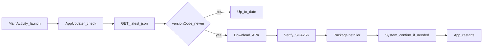

# Bookstr Android HTTPS OTA

Plan for remote APK updates over HTTPS. No Tailscale, WireGuard, or remote-adb.
USB `adb install` remains fine when the phone is physically present.

## Defaults

- **Host:** ship with empty `UpdateConfig.baseUrl` (OTA disabled until set).
- **Versioning:** replace minute-based `timestampVersionCode` with a manual
  integer `bookstrVersionCode` (start at `4`), bumped for every hosted release.
  Keep `BUILD_DATE` / timestamp only in `versionName` / display
  (e.g. `0.0.4-yyyyMMdd-HHmm`).
- **Install UX:** Bookstr is not Device Owner. Use `PackageInstaller`; expect
  `STATUS_PENDING_USER_ACTION` and launch the system confirmation Intent. No
  parent PIN — Settings gets a plain **Check now**.
- **Auto behavior:** Wi-Fi (unmetered) only by default; quiet check on launch
  (~daily); Settings force-check ignores Wi-Fi/interval.

## Cutover warning

Phones already on debug builds use huge timestamp `versionCode`s. Switching to
manual `4` means `install -r` / OTA will refuse until the installed package is
removed once. Plan a one-time USB reinstall onto the release keystore and new
version scheme before OTA works.



## Implementation

### 1. Version + signing — `android/app/build.gradle.kts`

- Add `bookstrVersionCode = 4` (bump for every OTA-hosted APK).
- Set `versionCode` to that int; `versionName` stays human-readable with a
  timestamp suffix.
- Keep existing `BOOKSTR_KEYSTORE_*` release signing; never host debug-signed
  APKs for OTA.
- Allow optional `BOOKSTR_VERSION_CODE` env override for CI.

### 2. Update client — `app.bookstr.update`

Port from Huddle (`basics/android/.../update/`), adapted:

- `UpdateConfig.kt` — empty `baseUrl`, path `/v1/android/latest.json`,
  `wifiOnly=true`, 24h interval
- `UpdateManifest.kt` — parse/validate HTTPS URL + 64-char sha256 via
  `org.json` (no new serialization plugin)
- `AppUpdater.kt` — prefs + StateFlow; fetch/download/verify/install; Wi-Fi +
  interval gates; OkHttp for network
- `UpdateInstallReceiver.kt` — session result; start confirmation Intent on
  pending user action

No `KioskController`. Cache file `bookstr-update-$code.apk`. Action
`app.bookstr.UPDATE_INSTALL_RESULT`.

### 3. Manifest + wiring

- `AndroidManifest.xml`: `REQUEST_INSTALL_PACKAGES`; register receiver
  (`exported=false`).
- `MainActivity.kt`: `AppUpdater.load` + quiet launch check.
- `SettingsScreen.kt`: status + **Check now** next to the existing version
  footer; minimal copy.

### 4. Tests + contract

- `UpdateManifestTest` (valid / reject http / bad sha / disabled config).
- Contract asserts for permission + receiver in `AndroidAppContractTest`.
- MockWebServer coverage for manifest fetch if kept thin.

### 5. Docs — `android/README.md`

Add an **Updates (OTA)** section covering release signing, bumping
`bookstrVersionCode`, `assembleRelease`, host layout (`latest.json` +
`bookstr-<versionCode>.apk`), manifest JSON shape, enabling via
`UpdateConfig.baseUrl`, checklist, and the debug-timestamp cutover note.

### 6. Non-goals (v1)

- Tailscale / WireGuard / remote-adb
- Play Store
- Relying on Device Owner silent install
- Deploying the first hosted APK in the initial client change (`baseUrl` stays
  empty)

## Verify

- `./gradlew testDebugUnitTest` for the update package + contract
- When a host exists: release on device → publish higher `versionCode` → Check
  now → system prompt → restart on new build

## Manifest shape

```json
{
  "versionCode": 12,
  "versionName": "0.0.12",
  "url": "https://example.com/bookstr-12.apk",
  "sha256": "<64-char lowercase hex of the APK>"
}
```
